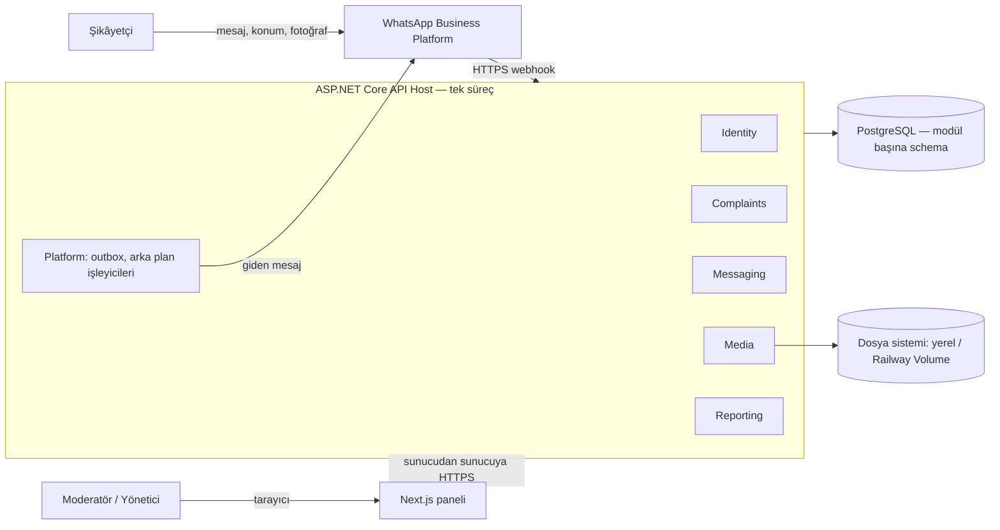
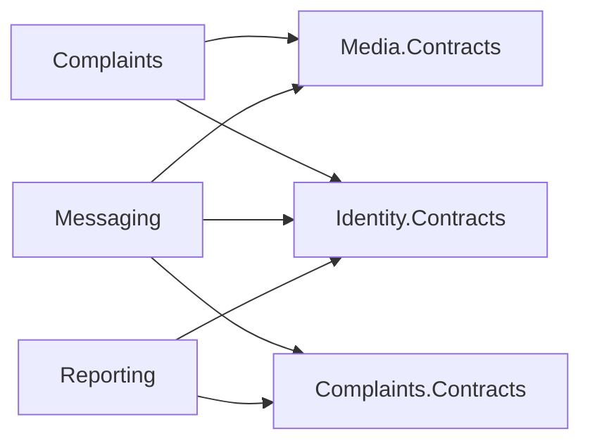
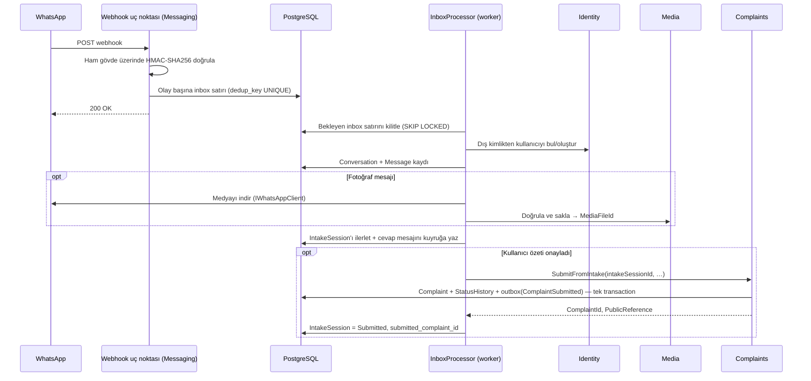
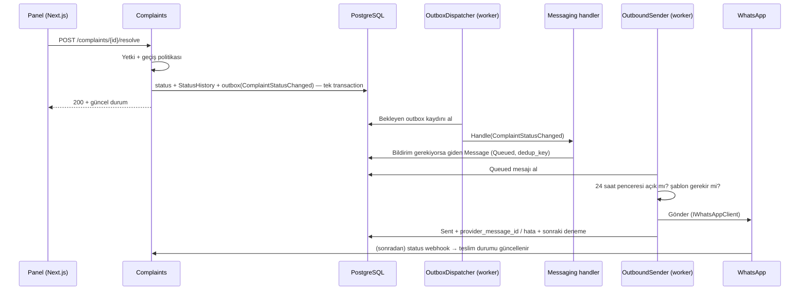

# Sokağımdaki Sorun — Mimari

| | |
|---|---|
| Doküman durumu | Kabul edildi (mimari hazırlık oturumu) |
| Son güncelleme | 2026-11-11 |
| Bağlayıcılık | Tüm implementasyon sohbetleri için bağlayıcıdır. Sapma gerekiyorsa önce ADR güncellenir. |

Bu doküman **neyin nerede yaşadığını ve kimin kiminle nasıl konuştuğunu** tanımlar. Veri modeli için [DOMAIN_MODEL](DOMAIN_MODEL.md), HTTP sözleşmeleri için [API_CONTRACT_STRATEGY](API_CONTRACT_STRATEGY.md) esas alınır.

> Depoda henüz kod yoktur. Aşağıdaki proje, dosya ve uç nokta adları **hedef tasarımdır**; var oldukları varsayılmamalıdır.

## 1. Sistem bağlamı



Üç çalıştırılabilir birim vardır: **Next.js paneli**, **.NET API host'u** (tüm modüller + arka plan işleyicileri aynı süreçte) ve **PostgreSQL**. Başka bir servis, kuyruk veya önbellek yoktur.

## 2. Çözüm düzeni (hedef)

```text
sokagimdakisorun/
├─ docs/                                   # bu dokümanlar
├─ src/
│  ├─ SokagimdakiSorun.Api/                # Host / Composition Root ("Core.Api" rolü)
│  ├─ SokagimdakiSorun.Platform/           # teknik altyapı: outbox, persistence konvansiyonları
│  ├─ SokagimdakiSorun.SharedKernel/       # çok küçük ortak teknik tipler
│  └─ Modules/
│     ├─ Identity/
│     │  ├─ SokagimdakiSorun.Identity/
│     │  └─ SokagimdakiSorun.Identity.Contracts/
│     ├─ Complaints/      (aynı ikili yapı)
│     ├─ Messaging/       (aynı ikili yapı)
│     ├─ Media/           (aynı ikili yapı)
│     └─ Reporting/
│        └─ SokagimdakiSorun.Reporting/    # Contracts yok: tüketen modül yok
├─ tests/
│  ├─ SokagimdakiSorun.<Modül>.Tests/      # modül birim testleri (ihtiyaç oldukça)
│  └─ SokagimdakiSorun.IntegrationTests/   # gerçek PostgreSQL + in-memory host
├─ web/                                    # Next.js uygulaması
├─ docker-compose.yml                      # yalnızca yerel PostgreSQL
└─ .env.example
```

Her modül projesinin iç klasörleri: `Domain/`, `Application/`, `Infrastructure/`, `Endpoints/`. Bunlar klasördür, ayrı proje değildir. Modül içi tipler varsayılan olarak `internal`'dır.

### Proje referans kuralları

Sınırlar **derleme zamanında proje referanslarıyla** korunur.

| Proje | Referans verebilir | Veremez |
|---|---|---|
| `*.Contracts` | `SharedKernel` | Başka her şey |
| Modül `X` | `SharedKernel`, `Platform`, `X.Contracts`, izinli `Y.Contracts` | Başka modülün ana projesi |
| `Platform` | `SharedKernel` | Herhangi bir modül |
| `Api` | Tüm modüller, `Platform`, `SharedKernel` | — |
| `SharedKernel` | Hiçbiri | — |

İzinli modüller arası bağımlılıklar (döngü yoktur):



`Identity` ve `Media` hiçbir modüle bağımlı değildir. Bu listeye yeni ok eklemek mimari karardır; PR açıklamasında gerekçelendirilir.

## 3. Modüller

| Modül | Schema | Sahip olduğu | Sahip olmadığı |
|---|---|---|---|
| **Identity** | `identity` | Kullanıcılar (şikâyetçi dâhil), roller, parola/oturum, dış kimlik eşleşmesi (WhatsApp `wa_id`) | Hizmet birimi üyeliği, şikâyet verisi |
| **Complaints** | `complaints` | Şikâyet aggregate'i, kategori, hizmet birimi ve üyeleri, yönlendirme kuralı, atama, durum geçmişi, yorum, ek ilişkisi, **durum geçiş politikası**, şikâyet erişim yetkisi | Dosya içeriği, mesaj gönderimi |
| **Messaging** | `messaging` | Webhook alımı ve doğrulaması, inbox, konuşma, mesaj, intake oturumu, giden mesaj kuyruğu, `IWhatsAppClient` adaptörleri | Şikâyet durumu, kullanıcı hesabı |
| **Media** | `media` | Dosya doğrulama, `IMediaStorage`, fiziksel saklama, dosya metadata'sı, yetim dosya temizliği | Dosyanın hangi şikâyete ait olduğu, erişim yetkisi kararı |
| **Reporting** | — | Dashboard ve istatistik uç noktaları (salt okuma) | Kendi tablosu yok; veriyi sözleşme üzerinden alır |
| **Platform** | `platform` | Outbox tablosu ve dağıtıcısı, persistence konvansiyonları, (ileride) audit log | İş kuralı |
| **Api (host)** | — | `Program.cs`, DI, middleware, kimlik doğrulama kurulumu, modül kaydı, hata formatı, OpenAPI, health check | İş kuralı, entity, DbContext |

### `Api` ve `SharedKernel` çöplük değildir

- Yeni bir iş kuralı "hiçbir modüle uymuyor" diye `Api`, `Platform` veya `SharedKernel`'e konmaz. Doğru modül genişletilir veya yeni modül önerilir.
- `SharedKernel` yalnızca şunları içerir: `Result`/`Error` tipi, `IIntegrationEvent` işaretleyicisi, `ICurrentUser` soyutlaması. Domain entity'si içermez. Buraya ekleme yapmak PR'da ayrıca gerekçelendirilir.
- Zaman için .NET'in yerleşik `TimeProvider`'ı, kimlik üretimi için `Guid.CreateVersion7()` kullanılır; bunlar için sarmalayıcı yazılmaz.

### Modül kayıt sözleşmesi

Her modül ana projesi iki genişletme metodu sunar; host yalnızca bunları çağırır:

```csharp
services.AddComplaintsModule(configuration);   // DI kayıtları
app.MapComplaintsEndpoints();                  // uç nokta grubu
```

Bootstrap sohbeti bu metotların boş gövdelerini tüm modüller için oluşturur. Böylece sonraki sohbetler `Program.cs` ve solution dosyasına dokunmadan kendi modüllerini doldurur (birleştirme çakışması önlenir).

## 4. Modüller arası iletişim

İki mekanizma vardır. Üçüncüsü (doğrudan tablo/DbContext erişimi) yasaktır.

### 4.1 Senkron: `*.Contracts` arayüzleri

Bir modül, başka modülden **anlık cevap** gerektiğinde onun `Contracts` projesindeki arayüzü çağırır. Arayüzü sahibi modül uygular ve DI'a kaydeder. Parametreler ve dönüşler DTO'dur; entity sızdırılmaz.

Her çağrı kendi modülünün transaction'ında çalışır. İki modülü kapsayan tek bir veritabanı transaction'ı **yoktur**; tutarlılık idempotency ile sağlanır (bkz. §5.1).

### 4.2 Asenkron: integration event + transactional outbox

Bir modül "bir şey oldu" bilgisini yayınlamak istediğinde, kendi `Contracts` projesinde tanımlı bir integration event'i **kendi iş verisiyle aynı transaction içinde** `platform.outbox_messages` tablosuna yazar. `OutboxDispatcher` arka plan işleyicisi kaydı okur ve DI'daki `IIntegrationEventHandler<T>` uygulamalarını süreç içinde çağırır.

- Teslim garantisi **en az bir kez**dir → her handler idempotent olmak zorundadır.
- Handler dış HTTP çağrısı yapmaz; yalnızca kendi modülünün verisini günceller (ör. giden mesaj kuyruğuna satır ekler).
- Bir handler hata verirse outbox kaydı backoff ile yeniden denenir; azami deneme sonrası `DeadLetter` olur.

Outbox tablosunun nasıl paylaşıldığı: [ADR-0002](decisions/ADR-0002-postgresql-data-ownership.md).

### 4.3 Hangi durumda hangisi

| İhtiyaç | Mekanizma |
|---|---|
| "Bu kullanıcı kim?", "Bu moderatör bu şikâyeti görebilir mi?" | Senkron sözleşme |
| Intake onaylandı → şikâyet oluştur | Senkron sözleşme (idempotent) |
| Şikâyet durumu değişti → şikâyetçiye haber ver | Integration event |
| Dosyayı sakla / oku | Senkron sözleşme |

Sözleşme ve event listesi: [API_CONTRACT_STRATEGY §7](API_CONTRACT_STRATEGY.md#7-modüller-arası-süreç-içi-sözleşmeler).

## 5. Ana akışlar

### 5.1 Gelen WhatsApp mesajından şikâyete



**Idempotency zinciri** — aynı girdinin tekrar işlenmesi ikinci bir kayıt üretmez:

| Katman | Koruma |
|---|---|
| Webhook tekrarı | `webhook_inbox_events.dedup_key` UNIQUE |
| Aynı mesajın iki kez kaydı | `messages.provider_message_id` UNIQUE |
| Intake'in iki kez gönderimi | `complaints.source_intake_session_id` UNIQUE → ikinci çağrı mevcut şikâyeti döndürür |
| Aynı event'in iki kez işlenmesi | Giden mesajda `dedup_key` UNIQUE |

İşleyici, şikâyet oluştuktan sonra ama intake'i `Submitted` yapmadan çökerse, inbox satırı yeniden denenir; `SubmitFromIntake` aynı şikâyeti döndürür ve akış tamamlanır.

### 5.2 Durum değişikliğinden şikâyetçi bildirimine



Açık bir veritabanı transaction'ı içinde dış HTTP çağrısı **bekletilmez**.

### 5.3 Arka plan işleyicileri

Hepsi API host sürecinde `BackgroundService` olarak çalışır.

| İşleyici | Sahibi | Görev |
|---|---|---|
| `InboxProcessor` | Messaging | Webhook olaylarını işler |
| `OutboundSender` | Messaging | Kuyruktaki mesajları sağlayıcıya gönderir |
| `IntakeExpirySweeper` | Messaging | Süresi dolan intake oturumlarını `Expired` yapar |
| `OutboxDispatcher` | Platform | Integration event'leri handler'lara dağıtır |
| `OrphanMediaCleaner` | Media | Bağlanmamış geçici dosyaları siler |

Ortak kurallar: satır kilitleme `FOR UPDATE SKIP LOCKED` ile; üstel backoff + jitter; azami deneme sonrası `DeadLetter`/`Failed`; `CancellationToken`'a uyarak kontrollü kapanma. Sonsuz yeniden deneme yoktur.

## 6. Kimlik ve yetkilendirme

### Kimlik doğrulama

- Parola, oturum ve hesap kilitleme mantığı **elle yazılmaz**; ASP.NET Core Identity kullanılır.
- Panel kullanıcıları (Admin, Moderator) e-posta + parola ile giriş yapar. Kendi kendine kayıt yoktur; moderatörü Admin oluşturur. İlk Admin ortam değişkenlerinden tohumlanır.
- Şikâyetçi de bir kullanıcı kaydıdır ama **parolası ve panel erişimi yoktur**. WhatsApp numarası `external_identities` üzerinden bağlanır. Numara bir kanal kimliğidir; resmî kimlik doğrulaması sayılmaz.
- Panel ↔ API oturum modeli: [ADR-0006](decisions/ADR-0006-admin-panel-authentication.md) (BFF: token tarayıcıya hiç ulaşmaz).

### Yetkilendirme

- Korumalı uç noktalar **varsayılan olarak reddeder** (fallback policy: kimliği doğrulanmış kullanıcı). Anonim erişim açıkça işaretlenir: webhook, login, health.
- İki katman:
  1. **Rol** — `Admin`, `Moderator`.
  2. **Kaynak kapsamı** — bir moderatörün belirli bir şikâyeti görüp göremeyeceği. Bu karar **Complaints modülüne** aittir; diğer modüller `IComplaintAccessPolicy` sözleşmesini çağırır.
- MVP kapsam kuralı:

| Şikâyetin durumu | Kim görebilir / işlem yapabilir |
|---|---|
| Atanmamış (triage havuzu) | Tüm moderatörler, Admin |
| Bir hizmet birimine atanmış | O birimin üyesi moderatörler, Admin |
| `Closed` → yeniden açma | Yalnızca Admin |

- Arayüzde düğme gizlemek yetkilendirme değildir. API her okuma ve yazma isteğinde kontrol eder.
- Şikâyet detayı yanıtı `allowedActions` listesi içerir; panel hangi düğmeyi göstereceğini buradan öğrenir, kural kopyalamaz.

## 7. Frontend ↔ API

- Panel Next.js 16 App Router ile yazılır; varsayılan Server Components, etkileşim gereken yerde Client Component.
- **Tarayıcı .NET API'ye doğrudan istek atmaz.** Tüm çağrılar Next.js sunucusundan (Server Component, Server Action, Route Handler) yapılır. Sonuç: CORS yapılandırması gerekmez, token tarayıcıya ulaşmaz.
- Next.js veritabanına bağlanmaz ve iş kuralı içermez. Durum geçiş kuralı, yetki kararı, doğrulama mesajı API'den gelir.
- TypeScript tipleri depodaki OpenAPI anlık görüntüsünden **üretilir**; elle DTO yazılmaz.
- Fotoğraflar Next.js Route Handler üzerinden akıtılır (oturum çerezi → API → dosya akışı).
- Tarih gösterimi `Europe/Istanbul`; API her zaman UTC döner.
- Arayüz dili Türkçedir. Çoklu dil altyapısı kurulmaz.

Ayrıntı: [API_CONTRACT_STRATEGY](API_CONTRACT_STRATEGY.md).

## 8. Medya

- Dosya içeriği veritabanına yazılmaz. `media.media_files` yalnızca metadata ve `storage_key` tutar.
- Diğer modüller dosyayı opak `MediaFileId` ile tanır; `storage_key` ve fiziksel yol **Media modülünün dışına çıkmaz**.
- Kabul kuralları: MIME allowlist (MVP: JPEG, PNG, WebP), boyut sınırı, imza (magic byte) kontrolü, SHA-256, rastgele storage key. Kullanıcının dosya adı yol olarak kullanılmaz.
- Erişim: Complaints uç noktası şikâyet yetkisini kontrol eder, sonra Media'dan akışı alır. Herkese açık statik dosya sunumu yoktur.

Ayrıntı: [ADR-0004](decisions/ADR-0004-local-first-media-storage.md).

## 9. Yapılandırma ve secret'lar

- Yapılandırma .NET `IConfiguration` üzerinden okunur; ortam değişkeninde bölüm ayırıcı `__`'dir.
- Secret'lar yalnızca ortam değişkeni / secret store'da yaşar. Veritabanında, `appsettings*.json`'da, kaynak kodda ve loglarda **bulunmaz**.
- `.env.example` yalnızca sahte değer içerir.

Planlanan anahtarlar (kesin adları ilgili sohbet belirler ve `.env.example`'a ekler):

| Anahtar | Sahibi | Secret? |
|---|---|---|
| `ConnectionStrings__Default` | Platform | Evet |
| `Database__ApplyMigrationsOnStartup` (varsayılan `false`; yalnızca geliştirme) | Platform | Hayır |
| `Outbox__Enabled`, `Outbox__PollingInterval`, `Outbox__BatchSize`, `Outbox__MaxAttempts`, `Outbox__BaseRetryDelay`, `Outbox__MaxRetryDelay` (hepsinin varsayılanı var) | Platform | Hayır |
| `Media__RootPath` | Media | Hayır |
| `WhatsApp__Provider` (`Mock` \| `CloudApi`) | Messaging | Hayır |
| `WhatsApp__VerifyToken`, `WhatsApp__AppSecret`, `WhatsApp__AccessToken` | Messaging | Evet |
| `WhatsApp__PhoneNumberId`, `WhatsApp__GraphApiVersion` | Messaging | Hayır |
| `Seed__AdminEmail`, `Seed__AdminPassword` | Identity | Evet |
| `API_BASE_URL` (Next.js, yalnızca sunucu tarafı) | web | Hayır |
| `SESSION_SECRET` (Next.js) | web | Evet |

`NEXT_PUBLIC_` önekli değişkenlere secret konmaz.

Platform anahtarlarının davranışı (WS-03): bağlantı dizesi kayıt sırasında değil bağlam ilk oluşturulduğunda okunur; yoksa `/health/ready` "Unhealthy" döner ve outbox dağıtıcısı çalışmaz. Build-zamanı araçlarında (`GetDocument.Insider`, `dotnet ef`) açılış migration'ı ve dağıtıcı çalışmaz. Yeni modül bağlamı: [guides/ADDING_A_MODULE_DBCONTEXT](guides/ADDING_A_MODULE_DBCONTEXT.md).

Identity anahtarlarının davranışı (WS-04): `Seed__AdminEmail` ve `Seed__AdminPassword` ikisi de tanımlıysa açılışta, migration'lardan sonra, bu e-postayla kullanıcı yoksa `Admin` rolüyle bir panel kullanıcısı oluşturulur; kullanıcı varsa parola dâhil hiçbir şey değişmez. Parola Identity parola politikasına (en az 12 karakter, büyük/küçük harf, rakam, sembol) uymazsa açılış hata ile durur. Build-zamanı araçlarında tohumlama çalışmaz. Token ömürleri (erişim 15 dk, yenileme 7 gün) ve kilitleme eşikleri (5 hata → 15 dk) koddadır, yapılandırma anahtarı yoktur.

## 10. Yerel geliştirme ortamı

| Bileşen | Nasıl çalışır |
|---|---|
| PostgreSQL 18 | `docker compose up -d` (yalnızca veritabanı konteyneri) |
| API | Host makinede `dotnet run` |
| Panel | Host makinede `npm run dev` |
| Medya | `./.local/media` (git dışı) |
| WhatsApp | `WhatsApp__Provider=Mock`; gelen mesaj, test amaçlı imzalanmış webhook isteğiyle simüle edilir |

- API ve panel konteynerde çalıştırılmaz (geliştirme döngüsü hızlı kalsın).
- Makinede projeyle ilgisiz konteynerler var; bootstrap sohbeti PostgreSQL için çakışmayan bir host portu seçer.
- Gerçek Meta secret'ı olmadan gerçek WhatsApp bağlantısı denenmez. Railway işlemi yapılmaz.

## 11. Hata yönetimi, loglama, gözlemlenebilirlik

- Hata yanıtları tek biçimdedir: RFC 9457 Problem Details (bkz. [API_CONTRACT_STRATEGY §4](API_CONTRACT_STRATEGY.md#4-hata-formatı)). Beklenen iş hataları exception yerine `Result` ile taşınır; beklenmeyen hatalar merkezi handler'da yakalanır ve ayrıntı yanıta sızdırılmaz.
- Loglama yerleşik `ILogger` ile yapılandırılmış (structured) biçimdedir. Ek loglama kütüphanesi gerekçesiz eklenmez.
- **Loglanmayanlar:** telefon numarası (maskelenir), mesaj metni, ham webhook gövdesi, token, imza, medya URL'si, dosya içeriği.
- Her istek ve arka plan işi bir korelasyon kimliği taşır.
- Health check: `/health/live` (süreç ayakta) ve `/health/ready` (veritabanı erişilebilir, medya kökü yazılabilir).
- İzlenecek sayaçlar (ilk aşamada log/health düzeyinde): reddedilen imza, tekrar eden webhook, inbox/outbox birikimi, dead-letter sayısı.

## 12. Test stratejisi

Kaynak politika: `lean-test-engineering` skill'i. Amaç test sayısı değil, en düşük katmanda en hızlı güvenilir kanıt.

| Katman | Neyi kanıtlar | Araç |
|---|---|---|
| Birim | Durum geçiş politikası, intake durum makinesi, doğrulama, eşleme | xUnit, bağımlılıksız |
| Bileşen | Yönlendirme, middleware, yetki, serileştirme, hata formatı | `WebApplicationFactory` (in-memory host) |
| Odaklı entegrasyon | Migration, UNIQUE/FK/CHECK, eşzamanlılık, transaction atomikliği, `SKIP LOCKED` | Testcontainers ile gerçek PostgreSQL |
| Sözleşme | OpenAPI anlık görüntüsü ile üretilen belge aynı mı | Build sırasında üretim + diff |
| Uçtan uca | Tek bir kritik yolculuk (mock WhatsApp → şikâyet → panel) | En sonda, çok az sayıda |

Bağlayıcı kurallar:

- PostgreSQL davranışı SQLite veya in-memory sağlayıcıyla **taklit edilmez**.
- Mock sağlayıcının geçmesi, gerçek WhatsApp'ın çalıştığını **kanıtlamaz**; raporlarda bu sınır açıkça yazılır.
- Testler üretim verisi, gerçek secret veya gerçek mesaj gönderimi kullanmaz.
- Zaman `TimeProvider` ile sabitlenir; `sleep` ile eşzamanlama yapılmaz.
- Her PR, çalıştırılan komutları ve sonuçlarını; çalıştırılmayanları ve nedenini bildirir.

Modül başına asgari test kapsamı: [WORKSTREAMS_AND_BRANCHES](WORKSTREAMS_AND_BRANCHES.md) içindeki iş akışı kartları.

## 13. Deployment (sonraki faz — şimdi uygulanmaz)

Hedef topoloji: Railway üzerinde üç servis — Next.js, API (+ aynı süreçte worker'lar, + Volume), PostgreSQL.

Şimdiden tasarımı etkileyen bilinen kısıtlar (uygulama anında güncel Railway dokümanından yeniden doğrulanır):

- Volume bağlı servis yatay ölçeklenemez → API tek örnek çalışır. Worker'ların API ile aynı süreçte olması bu yüzden bilinçli bir tercihtir.
- Volume build ve pre-deploy aşamasında bağlı değildir → medya kökü yalnızca çalışma zamanında kullanılır.
- Veritabanı yedeği Volume'u kapsamaz → medya yedeği ayrı planlanır.
- Railway'in ücretsiz alan adları ortak bir "public suffix" altındadır; servisler arası çerez paylaşımı yapılamaz. [ADR-0006](decisions/ADR-0006-admin-panel-authentication.md) bu kısıttan etkilenmeyecek şekilde tasarlanmıştır.

## 14. Kesitsel kurallar

| Konu | Kural |
|---|---|
| Kimlikler | `Guid` (v7). Dışarıya ardışık sayı verilmez; insanlar için `PublicReference` |
| Zaman | `timestamptz` / `DateTimeOffset`, her zaman UTC. Gösterim katmanında `Europe/Istanbul` |
| Enum saklama | Metin olarak + `CHECK` kısıtı |
| Adlandırma (DB) | `snake_case`, çoğul tablo adları |
| Asenkron | I/O yapan her metot `CancellationToken` alır |
| API yanıtı | Entity doğrudan serileştirilmez; DTO/projeksiyon |
| Silme | Şikâyet, yorum ve geçmiş cascade ile silinmez; gerekiyorsa anonimleştirme |
| Bağımlılık | Yeni paket eklemek PR'da gerekçelendirilir |
| Paket sürümleri | Merkezi paket yönetimi (`Directory.Packages.props`) |
