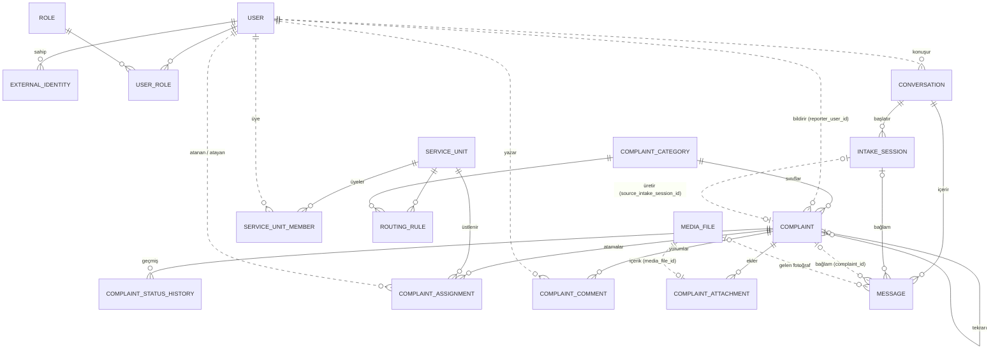
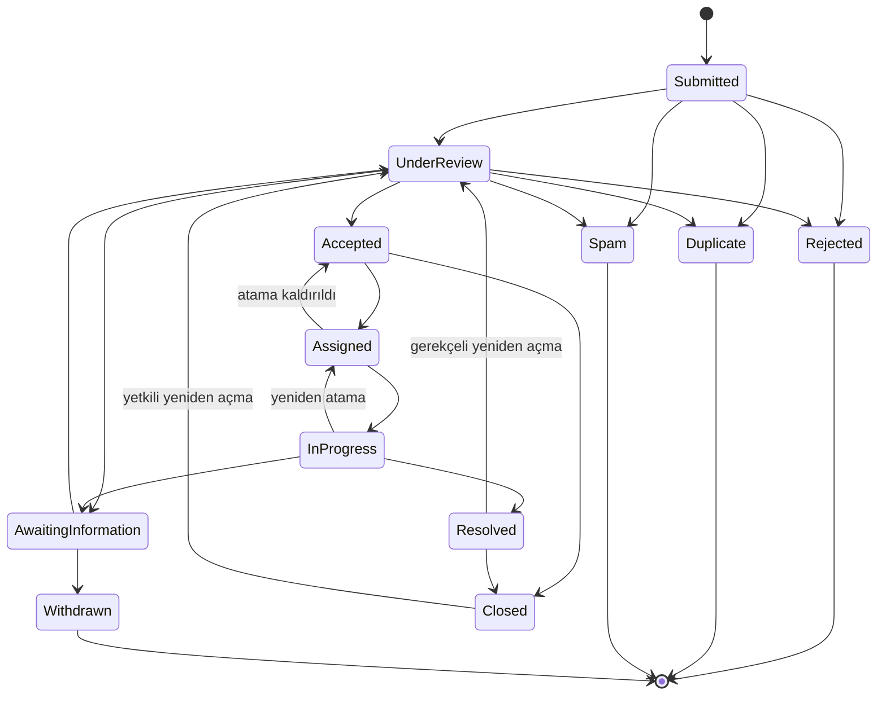
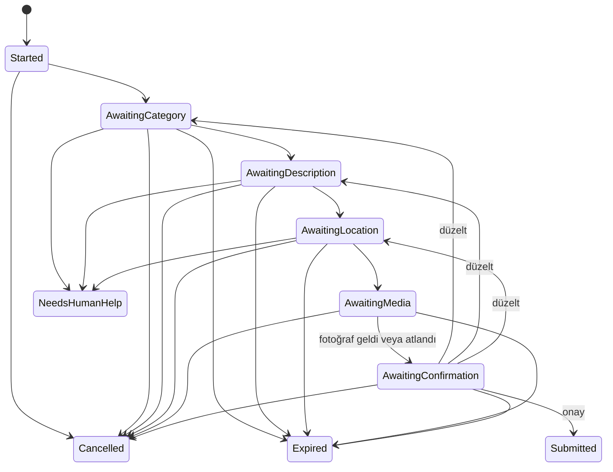

# Sokağımdaki Sorun — Domain Modeli

| | |
|---|---|
| Doküman durumu | Kabul edildi (mimari hazırlık oturumu) |
| Son güncelleme | 2026-11-11 |
| Bağlayıcılık | Durum kümeleri, geçiş tabloları ve tablo sahipliği bağlayıcıdır. Kolon listeleri başlangıç tasarımıdır; ilgili sohbet gerçek sorgu ihtiyacına göre netleştirir. |

> Henüz hiçbir tablo veya migration yoktur. Bu doküman hedef modeldir.

## 1. Temel ayrım: Conversation ≠ IntakeSession ≠ Complaint

| Kavram | Ne | Ömrü | Sahibi |
|---|---|---|---|
| **Conversation** | Bir şikâyetçi ile işletme numarası arasındaki WhatsApp iletişim bağlamı | Kalıcı; kişi başına tek | Messaging |
| **Message** | Tek bir gelen veya giden mesaj | Kalıcı (saklama süresine tabi) | Messaging |
| **IntakeSession** | Bir şikâyet için bilgilerin toplandığı geçici süreç | Kısa; tamamlanır, iptal edilir veya zaman aşımına uğrar | Messaging |
| **Complaint** | Kullanıcı onayından sonra oluşan kalıcı iş kaydı | Kalıcı | Complaints |

Kurallar:

- Her WhatsApp mesajı yeni bir şikâyet **değildir**.
- Bir konuşmada zaman içinde birden çok intake ve birden çok şikâyet olabilir.
- Bir konuşmada aynı anda **en fazla bir** aktif intake bulunur.
- Bir intake **en fazla bir** şikâyet üretir. Aynı intake tekrar işlenirse aynı şikâyet döner.
- Intake tamamlanıp kullanıcı onay vermeden şikâyet oluşturulmaz.

## 2. Entity ilişkileri

Kesikli çizgiler **modül sınırını aşan** ilişkilerdir: veritabanında foreign key yoktur, yalnızca skaler kimlik saklanır ve sahip modülün sözleşmesiyle doğrulanır.

## 3. Tablo sahipliği

"MVP" sütunu: **✔** ilk sürümde oluşturulur · **⏳** ihtiyaç doğduğunda · **✖** oluşturulmaz.

### 3.1 `identity` schema — Identity modülü

| Tablo | MVP | Önemli alanlar / kısıtlar |
|---|---|---|
| `users` | ✔ | ASP.NET Core Identity kullanıcı tablosu + `user_kind` (`Staff` \| `Reporter`), `status` (`Active` \| `Suspended` \| `Anonymized`), `display_name`, `created_at`. Şikâyetçinin parola hash'i yoktur (CHECK `ck_users_reporter_has_no_password`). `normalized_email` UNIQUE (şikâyetçide NULL). |
| `roles`, `user_roles` | ✔ | `Admin`, `Moderator`. Şikâyetçinin rolü yoktur. |
| Identity'nin diğer standart tabloları | ✖ | WS-04'te elendi: `user_claims`, `role_claims`, `user_logins`, `user_tokens` oluşturulmaz (özel claims fabrikası; harici giriş ve 2FA yok). `users`'ta `phone_number`, `phone_number_confirmed`, `two_factor_enabled` kolonları da yok. Roller migration ile tohumlanır. |
| `external_identities` | ✔ | `user_id` FK, `provider` (`WhatsApp`; metin + CHECK), `external_id` (`wa_id`, en çok 64), `created_at`. **UNIQUE(`provider`, `external_id`)** (`ux_external_identities_provider_external_id`). |
| `permissions`, `role_permissions` | ✖ | Rol + policy yeterlidir. |

### 3.2 `complaints` schema — Complaints modülü

| Tablo | MVP | Önemli alanlar / kısıtlar |
|---|---|---|
| `complaints` | ✔ | Aşağıda §3.2.1 |
| `complaint_categories` | ✔ | `code` UNIQUE, `name`, `description`, `is_active`, `sort_order`. MVP'de düz liste (alt kategori yok). |
| `service_units` | ✔ | `code` UNIQUE, `name`, `is_active`. Temsili birimler. |
| `service_unit_members` | ✔ | PK(`service_unit_id` FK, `user_id` skaler). Moderatörün yetki kapsamı. |
| `routing_rules` | ✔ | `category_id` FK, `service_unit_id` FK, `district` (nullable, MVP'de kullanılmaz), `priority`, `is_active`. Yalnızca **öneri** üretir; atamayı moderatör onaylar. |
| `complaint_assignments` | ✔ | `complaint_id` FK, `service_unit_id` FK, `assignee_user_id` (nullable), `assigned_by_user_id`, `assigned_at`, `unassigned_at` (nullable), `reason`. **Kısmi UNIQUE(`complaint_id`) WHERE `unassigned_at IS NULL`** → tek aktif atama. |
| `complaint_status_history` | ✔ | Aşağıda §4.4. Yalnızca ekleme; güncellenmez, silinmez. |
| `complaint_comments` | ✔ | `complaint_id` FK, `author_user_id`, `author_kind`, `body`, `visibility` (`Internal` \| `ReporterVisible`), `source` (`Panel` \| `WhatsApp`), `created_at`. |
| `complaint_attachments` | ✔ | `complaint_id` FK, `media_file_id` (skaler, UNIQUE), `source` (`Intake` \| `InformationReply` \| `Panel`), `added_by_user_id`, `created_at`. **Dosya yolu veya storage key içermez.** |
| `complaint_tags`, `complaint_tag_links` | ✖ | İhtiyaç yok. |

**Hizmet birimi üyeliği neden burada?** Kapsam filtresi ("moderatör yalnızca kendi birimine atanmış şikâyetleri görür") şikâyet listesinin en sık sorgusudur ve `complaints → complaint_assignments → service_unit_members` birleşimi gerektirir. Üçü de aynı schema'da olunca modül sınırı aşılmaz ve `service_units`'e gerçek FK kurulabilir.

#### 3.2.1 `complaints` tablosu

| Alan | Not |
|---|---|
| `id` | Guid v7, PK |
| `public_reference` | **UNIQUE**. `SS-XXXX-XXXX`, rastgele, karıştırılması zor karakter kümesi. Ardışık değildir. |
| `reporter_user_id` | Skaler (Identity) |
| `category_id` | FK |
| `description` | Zorunlu metin. Ayrı bir başlık alanı yoktur (intake başlık toplamaz). |
| `status` | Metin + CHECK (§4.1) |
| `source_channel` | `WhatsApp` (ileride başka kanallar) |
| `source_intake_session_id` | Skaler (Messaging). **Kısmi UNIQUE WHERE NOT NULL** → intake başına tek şikâyet |
| `duplicate_of_complaint_id` | Öz-referans FK, nullable. CHECK: kendine eşit olamaz |
| `latitude`, `longitude` | Nullable; CHECK aralıkları (−90..90, −180..180) |
| `address_text` | Nullable |
| `location_source` | `WhatsAppPin` \| `TextAddress` |
| `submitted_at`, `resolved_at`, `closed_at` | UTC |
| `created_at`, `updated_at` | UTC |
| eşzamanlılık belirteci | İyimser kilit (tercih: Npgsql'in `xmin` desteği; Complaints sohbetinde doğrulanır) |

Konum ayrı tabloda değil, şikâyetle birlikte saklanır (1:1, her zaman birlikte okunur). CHECK: koordinat çifti **veya** adres metninden en az biri dolu olmalı.

Başlangıç index adayları (ölçmeden daha fazlası eklenmez): `(status, created_at DESC)`, `(category_id, status, created_at DESC)`, `(reporter_user_id)`.

### 3.3 `messaging` schema — Messaging modülü

| Tablo | MVP | Önemli alanlar / kısıtlar |
|---|---|---|
| `conversations` | ✔ | `reporter_user_id` (skaler), `channel`, `business_phone_number_id`, `external_contact_id`, `last_inbound_at`, `awaiting_reply_complaint_id` (skaler, nullable), zaman damgaları. **UNIQUE(`business_phone_number_id`, `external_contact_id`)**. |
| `messages` | ✔ | `conversation_id` FK, `direction` (`Inbound` \| `Outbound`), `provider_message_id` (**kısmi UNIQUE WHERE NOT NULL**), `message_type`, `text_body`, `latitude`/`longitude`, `media_file_id` (skaler), `intake_session_id` FK nullable, `complaint_id` (skaler, nullable), `delivery_status`, `dedup_key` (**kısmi UNIQUE**, giden mesajlarda), `attempt_count`, `next_attempt_at`, `last_error`, `provider_timestamp`, `created_at`. |
| `intake_sessions` | ✔ | `conversation_id` FK, `state` (§5), taslak alanlar (`category_id` skaler, `description_draft`, konum taslağı, `media_file_ids`), `submitted_complaint_id` (skaler, **kısmi UNIQUE**), `expires_at`, zaman damgaları. **Kısmi UNIQUE(`conversation_id`) WHERE state aktif** → tek aktif intake. |
| `webhook_inbox_events` | ✔ | `provider`, `dedup_key` (**UNIQUE**), `event_type`, `payload` (jsonb), `received_at`, `processing_state`, `attempt_count`, `next_attempt_at`, `processed_at`, `last_error`. |

- Giden mesaj kuyruğu ayrı tablo değildir: `messages` içindeki `Outbound` + `Queued` satırlar kuyruğun kendisidir.
- Tek webhook isteği birden çok mesaj/durum olayı taşıyabilir; kabul sırasında **olay başına bir inbox satırı** yazılır. `dedup_key` biçimi: mesaj için `msg:{provider_message_id}`, durum için `status:{provider_message_id}:{status}`.
- JSONB yalnızca sağlayıcı payload'ı içindir; kategori, durum, konum gibi iş verisi JSON'a gömülmez.

**Mesaj teslim durumu** (şikâyet durumundan tamamen bağımsızdır):

| Yön | Değerler |
|---|---|
| Gelen | `Received` |
| Giden | `Queued → Sending → Sent → Delivered → Read`, veya `Failed` |

### 3.4 `media` schema — Media modülü

| Tablo | MVP | Önemli alanlar / kısıtlar |
|---|---|---|
| `media_files` | ✔ | `storage_provider`, `storage_key` (**UNIQUE**, rastgele), `content_type`, `size_bytes` (CHECK > 0), `sha256`, `status` (`Temporary` \| `Committed` \| `Deleted`), `created_at`, `committed_at`. |

Dosya önce `Temporary` olarak kaydedilir; bir şikâyete bağlandığında `Committed` olur. Belirli süre `Temporary` kalan dosyalar temizlenir (terk edilmiş intake'lerin fotoğrafları).

### 3.5 `platform` schema — Platform

| Tablo | MVP | Not |
|---|---|---|
| `outbox_messages` | ✔ | `id` (= event'in `EventId`'si), `type`, `payload` (jsonb), `occurred_at`, `available_at`, `attempt_count`, `processed_at`, `dead_lettered_at`, `last_error`. Bekleyenleri taramak için `available_at` üzerinde kısmi index `ix_outbox_messages_pending` (`WHERE processed_at IS NULL AND dead_lettered_at IS NULL`). `CHECK`: `attempt_count >= 0`; `processed_at` ve `dead_lettered_at` aynı anda dolu olamaz. Migration: `InitialPlatform` (WS-03). |
| `audit_logs` | ⏳ | Şikâyet hareketleri zaten `complaint_status_history` ve `complaint_assignments` ile izlenir. Bu tablo, Identity'de rol/kullanıcı yönetimi geldiğinde değerlendirilir. |
| `system_settings` | ✖ | Dinamik ayar ihtiyacı kanıtlanana kadar oluşturulmaz. Secret'lar hiçbir zaman burada tutulmaz. |

## 4. Şikâyet yaşam döngüsü

### 4.1 Durumlar

| Durum | Anlamı | Terminal mi |
|---|---|---|
| `Submitted` | Şikâyetçinin onayladığı, sisteme alınmış başvuru | Hayır |
| `UnderReview` | Moderatör ilk incelemeyi yapıyor | Hayır |
| `AwaitingInformation` | Şikâyetçiden ek bilgi bekleniyor | Hayır |
| `Accepted` | Geçerli bulundu, işleme kabul edildi | Hayır |
| `Assigned` | Hizmet birimine (ve isteğe bağlı kişiye) atandı | Hayır |
| `InProgress` | Çözüm çalışması sürüyor | Hayır |
| `Resolved` | Sorumlu taraf çözüldüğünü bildirdi | Hayır |
| `Closed` | Son kontrol yapıldı, kayıt kapatıldı | Hayır (yetkili yeniden açabilir) |
| `Rejected` | Kapsam dışı veya geçersiz | **Evet** |
| `Duplicate` | Başka bir şikâyetin tekrarı | **Evet** |
| `Spam` | Kötüye kullanım | **Evet** |
| `Withdrawn` | Şikâyetçi geri çekti | **Evet** |

`Reopened` diye bir durum yoktur. Yeniden açma bir **komuttur**; kayıt `UnderReview`'a döner ve gerekçe geçmişe yazılır. `Resolved` ile `Closed` ayrıdır: çözüm bildirimi ile son kontrol aynı eylem değildir.

### 4.2 Durum diyagramı

### 4.3 İzin verilen geçişler (bağlayıcı tablo)

Bu tabloda olmayan her geçiş **yasaktır**.

| # | Nereden | Nereye | Komut | Kim | Gerekçe | Ek koşul |
|---|---|---|---|---|---|---|
| 1 | *(yok)* | `Submitted` | `SubmitFromIntake` | Sistem (şikâyetçi adına) | — | Onaylı intake |
| 2 | `Submitted` | `UnderReview` | `StartReview` | Moderatör | — | |
| 3 | `Submitted` | `Rejected` | `Reject` | Moderatör | **Zorunlu** | |
| 4 | `Submitted` | `Duplicate` | `MarkDuplicate` | Moderatör | **Zorunlu** | Hedef şikâyet zorunlu |
| 5 | `Submitted` | `Spam` | `MarkSpam` | Moderatör | **Zorunlu** | |
| 6 | `UnderReview` | `AwaitingInformation` | `RequestInformation` | Moderatör | **Zorunlu** | Şikâyetçiye gidecek soru metni zorunlu |
| 7 | `UnderReview` | `Accepted` | `Accept` | Moderatör | — | |
| 8 | `UnderReview` | `Rejected` | `Reject` | Moderatör | **Zorunlu** | |
| 9 | `UnderReview` | `Duplicate` | `MarkDuplicate` | Moderatör | **Zorunlu** | Hedef şikâyet zorunlu |
| 10 | `UnderReview` | `Spam` | `MarkSpam` | Moderatör | **Zorunlu** | |
| 11 | `AwaitingInformation` | `UnderReview` | `ProvideInformation` / `ResumeReview` | Şikâyetçi (WhatsApp) / Moderatör | — | |
| 12 | `AwaitingInformation` | `Withdrawn` | `Withdraw` | Şikâyetçi (WhatsApp) | İsteğe bağlı | |
| 13 | `Accepted` | `Assigned` | `Assign` | Moderatör | — | Hizmet birimi zorunlu |
| 14 | `Accepted` | `Closed` | `Close` | Moderatör | **Zorunlu** | İşlem gerektirmeden kapatma |
| 15 | `Assigned` | `InProgress` | `StartWork` | Moderatör | — | |
| 16 | `Assigned` | `Accepted` | `Unassign` | Moderatör | **Zorunlu** | Aktif atama kapatılır |
| 17 | `InProgress` | `Resolved` | `Resolve` | Moderatör | **Zorunlu** (çözüm notu) | |
| 18 | `InProgress` | `AwaitingInformation` | `RequestInformation` | Moderatör | **Zorunlu** | Soru metni zorunlu |
| 19 | `InProgress` | `Assigned` | `Reassign` | Moderatör | **Zorunlu** | Yeni birim/kişi zorunlu |
| 20 | `Resolved` | `Closed` | `Close` | Moderatör | — | |
| 21 | `Resolved` | `UnderReview` | `Reopen` | Moderatör | **Zorunlu** | |
| 22 | `Closed` | `UnderReview` | `Reopen` | **Yalnızca Admin** | **Zorunlu** | |

"Moderatör" her yerde "yetki kapsamındaki moderatör veya Admin" demektir.

Ek kurallar:

- **Durum değiştirmeyen atama değişikliği:** `Assigned` durumundaki bir şikâyetin birimi/kişisi değiştirilirse durum aynı kalır; eski atama kapatılır, yenisi açılır. Bu hareket `complaint_assignments`'ta izlenir, durum geçmişine satır eklenmez.
- **Tekrar (duplicate):** hedef şikâyet kendisi olamaz; hedef de `Duplicate` durumunda olamaz (zincir/döngü engeli).
- **Terminal durumlardan geri dönüş** MVP'de yoktur. İhtiyaç doğarsa ayrı, yalnızca Admin'e açık bir komut olarak tasarlanır.
- **Açık karar OD-3:** `InProgress → AwaitingInformation` (#18) sonrası cevap geldiğinde kayıt #11 ile `UnderReview`'a döner ve moderatör `Accept → Assign → StartWork` adımlarını tekrarlamak zorunda kalır. Öneri: `AwaitingInformation → InProgress` geçişini "bu duruma `InProgress`'ten girildiyse" koşuluyla eklemek. Proje sahibi onaylayana kadar tablo yukarıdaki gibidir.

### 4.4 Durum geçmişi

Her geçiş için `complaint_status_history`'ye **aynı transaction içinde** bir satır eklenir:

| Alan | Not |
|---|---|
| `complaint_id` | FK |
| `from_status` | İlk satırda NULL |
| `to_status` | |
| `actor_kind` | `Staff` \| `Reporter` \| `System` |
| `actor_user_id` | `System` için NULL |
| `source` | `Panel` \| `WhatsApp` \| `System` |
| `reason` | İç gerekçe. Şikâyetçiye **gönderilmez**. |
| `reporter_note` | Şikâyetçiye iletilecek metin (isteğe bağlı; ret gerekçesi, soru vb.) |
| `occurred_at` | UTC |

`reason` ile `reporter_note` ayrımı, iç değerlendirmenin şikâyetçiye sızmasını önler.

### 4.5 Uygulama kuralları

1. Geçiş tablosu kodda **tek bir yerde** yaşar: Complaints modülünün domain katmanındaki geçiş politikası. Endpoint, WhatsApp handler'ı veya panel kendi kuralını yazmaz.
2. Durum hiçbir zaman doğrudan atanmaz; yalnızca komut metotları değiştirir.
3. Durum güncellemesi + geçmiş satırı + outbox event'i tek transaction'dır.
4. Eşzamanlı iki güncellemeden ikincisi iyimser kilit hatası alır; API `409 Conflict` döner ve panel güncel durumu gösterir.
5. Şikâyet, yorum ve geçmiş cascade ile silinmez.

## 5. Intake durum makinesi

| Durum | Aktif mi | Not |
|---|---|---|
| `Started` … `AwaitingConfirmation` | Evet | Konuşma başına en fazla bir tane |
| `Submitted` | Hayır | `submitted_complaint_id` dolu |
| `Cancelled` | Hayır | Kullanıcı vazgeçti |
| `Expired` | Hayır | Belirli süre hareketsiz kaldı (süre yapılandırılabilir) |
| `NeedsHumanHelp` | Hayır | Akış ilerletilemedi; moderatör kuyruğunda işaretlenir |

Kurallar:

- Fotoğraf isteğe bağlıdır; kategori, açıklama ve konum zorunludur.
- Konum, WhatsApp konum mesajı (koordinat) **veya** açık adres metni olabilir. MVP'de adres metninden koordinat üretilmez.
- Özet gösterilip **açık onay** alınmadan `Submitted` olunmaz. Otomatik çıkarım onayın yerini tutmaz.
- Intake durumları ile şikâyet durumları ayrı kümelerdir; `Submitted` adının iki yerde geçmesi tesadüftür, aynı alan değildir.

### Gelen mesajın yönlendirme önceliği

`InboxProcessor` bir gelen mesajı sırayla şu kurallara göre ele alır:

1. Teslim durumu olayı mı? → ilgili giden mesajın `delivery_status`'ünü güncelle.
2. Konuşmada aktif intake var mı? → intake'i ilerlet.
3. Konuşma bir şikâyet için cevap bekliyor mu (`awaiting_reply_complaint_id`)? → mesajı o şikâyete ek bilgi olarak ilet (`ProvideInformation`).
4. Hiçbiri → yeni intake başlat.

Desteklenmeyen mesaj tipi (ses, video, belge vb.) kaydedilir, kullanıcıya desteklenen tipler açıklanır; sistem hata vermez.

## 6. Değişmezler (invariant) özeti

| # | Kural | Nerede zorlanır |
|---|---|---|
| I-1 | Bir intake en fazla bir şikâyet üretir | `complaints.source_intake_session_id` kısmi UNIQUE + idempotent komut |
| I-2 | Aynı sağlayıcı mesajı bir kez kaydedilir | `messages.provider_message_id` kısmi UNIQUE |
| I-3 | Aynı webhook olayı bir kez işlenir | `webhook_inbox_events.dedup_key` UNIQUE |
| I-4 | Konuşma başına tek aktif intake | Kısmi UNIQUE index |
| I-5 | Şikâyet başına tek aktif atama | Kısmi UNIQUE index |
| I-6 | Her durum değişikliğinin geçmiş satırı vardır | Domain komutu + tek transaction |
| I-7 | Yasak geçiş gerçekleşemez | Domain geçiş politikası (+ birim testleri) |
| I-8 | Bir dış kimlik tek kullanıcıya bağlıdır | `external_identities` UNIQUE |
| I-9 | Şikâyet kendisinin tekrarı olamaz | CHECK + domain kuralı |
| I-10 | Dosya yolu Media modülü dışına çıkmaz | Sözleşme tasarımı (yalnızca `MediaFileId`) |

Veritabanı kısıtları yalnızca C# doğrulamasına bırakılmaz; `NOT NULL`, `UNIQUE`, `CHECK` ve modül içi `FOREIGN KEY` veritabanında da tanımlanır.

## 7. Gizlilik ve saklama

- Şikâyetçiden ad-soyad, kimlik numarası gibi gereksiz kişisel veri istenmez. Telefon numarası yalnızca kanal kimliği olarak tutulur.
- MVP'de tüm şikâyetler özeldir; herkese açık görünüm yoktur.
- Fotoğraflardaki EXIF/GPS verisi kamuya açılmaz. Temizleme stratejisi Media sohbetinde belirlenir.
- Ham webhook payload'ı ve mesaj metinleri için saklama süresi tanımlanmalıdır (gerçek kullanıma açılmadan önce; KVKK değerlendirmesi proje sahibinin sorumluluğundadır).
- Kullanıcı silme talebi kayıt silerek değil **anonimleştirerek** karşılanır; şikâyet geçmişi korunur.
- Testlerde ve yerel ortamda yalnızca temsili veri kullanılır.
