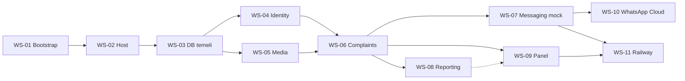

# Sokağımdaki Sorun — Uygulama Yol Haritası

| | |
|---|---|
| Doküman durumu | Yaşayan doküman — her PR ilgili satırı günceller |
| Son güncelleme | 2026-11-11 |

Sıra, gerçek teknik bağımlılıklara göre belirlenmiştir. İş akışlarının ayrıntılı kapsamı ve dosya sahipliği: [WORKSTREAMS_AND_BRANCHES](WORKSTREAMS_AND_BRANCHES.md).

## 1. Güncel durum

| # | İş akışı | Branch | Durum |
|---|---|---|---|
| WS-00 | Mimari hazırlık | `main` (ilk commit) | ✅ Tamamlandı (2026-11-11) |
| WS-01 | Proje iskeleti | `chore/project-bootstrap` | ✅ Tamamlandı (2026-11-11, `main`'e merge edildi) |
| WS-02 | API host | `feature/backend-host` | ✅ Tamamlandı (2026-11-11, `main`'e merge edildi) |
| WS-03 | Veritabanı temeli | `feature/database-foundation` | ✅ Tamamlandı (2026-11-11, `main`'e merge edildi) |
| WS-04 | Identity modülü | `feature/backend-identity` | ✅ Tamamlandı (2026-11-11, `main`'e merge edildi) |
| WS-05 | Media modülü | `feature/backend-media` | ✅ Tamamlandı (2026-11-11, `main`'e merge edildi) |
| WS-06 | Complaints modülü | `feature/backend-complaints` | ✅ Tamamlandı (2026-11-11, `main`'e merge edildi) |
| WS-07 | Messaging modülü (mock sağlayıcı) | `feature/backend-messaging` | İncelemede (2026-11-12; remote yok, PR açıklaması hazır) |
| WS-08 | Reporting modülü | `feature/backend-reporting` | Bekliyor |
| WS-09 | Yönetim paneli | `feature/frontend-admin` | İncelemede (2026-11-12; dashboard ve konuşma görünümü WS-08/WS-07 uç noktalarını bekliyor — yer tutucu) |
| WS-10 | Gerçek WhatsApp Cloud API | `feature/whatsapp-cloud-integration` | Sonraki faz |
| WS-11 | Railway deployment | `chore/railway-deployment` | Sonraki faz |

Durum değerleri: Bekliyor · Devam ediyor · İncelemede (PR açık) · ✅ Tamamlandı · ⛔ Engelli.

## 2. Bağımlılık grafiği

Paralel çalışılabilecek çiftler (ayrı worktree şartıyla):

- **WS-04 Identity ∥ WS-05 Media** — birbirine bağımlı değil, farklı dosyalar.
- **WS-07 Messaging ∥ WS-09 Panel** — Complaints `main`'e girdikten sonra. Panel yalnızca OpenAPI anlık görüntüsüne, Messaging yalnızca `Complaints.Contracts`'a bağlıdır.
- **WS-08 Reporting** küçük bir iştir; WS-09'un dashboard ekranından önce bitmesi yeterlidir.

Tek geliştirici için önerilen doğrusal sıra: 01 → 02 → 03 → 04 → 05 → 06 → 07 → 08 → 09 → 10 → 11.

## 3. Fazlar ve kilometre taşları

### Faz 0 — Mimari hazırlık ✅

Çıktı: bu `docs/` klasörü, yerel Git deposu, `main` dalı.

### Faz 1 — Temel (WS-01, WS-02, WS-03)

**Hedef:** Boş ama doğru sınırlara sahip, çalışan bir backend iskeleti.

**Kilometre taşı M1 — "İskelet ayakta":**

- `dotnet build` ve `dotnet test` temiz geçer.
- `docker compose up -d` yerel PostgreSQL'i başlatır; API `/health/ready` üzerinden veritabanına eriştiğini bildirir.
- Tüm modül projeleri ve boş kayıt metotları yerindedir; proje referansları [ARCHITECTURE §2](ARCHITECTURE.md#2-çözüm-düzeni-hedef) kurallarına uyar.
- Hata formatı, OpenAPI anlık görüntü mekanizması, outbox tablosu ve dağıtıcısı, entegrasyon testi altyapısı (gerçek PostgreSQL) hazırdır.

### Faz 2 — Çekirdek domain (WS-04, WS-05, WS-06)

**Hedef:** Şikâyet yaşam döngüsü API üzerinden uçtan uca çalışır (WhatsApp olmadan; şikâyet test verisiyle veya sözleşme çağrısıyla oluşturulur).

**Kilometre taşı M2 — "Yaşam döngüsü kanıtlandı":**

- Moderatör giriş yapar, token alır.
- Bir şikâyet `Submitted → … → Closed` yolunu izler; her adım geçmişte görünür.
- [DOMAIN_MODEL §4.3](DOMAIN_MODEL.md#43-izin-verilen-geçişler-bağlayıcı-tablo) tablosundaki her izinli geçiş ve temsili yasak geçişler birim testleriyle doğrulanmıştır.
- Kapsam dışı moderatör şikâyeti göremez (test ile).
- Dosya saklanır, yetkili kullanıcıya akıtılır; yanıtlarda dosya yolu yoktur.

### Faz 3 — Kanal ve arayüz (WS-07, WS-08, WS-09)

**Hedef:** Vatandaştan moderatöre tam akış, yerelde, mock sağlayıcıyla.

**Kilometre taşı M3 — "MVP yerelde çalışıyor":**

- İmzalanmış test webhook'larıyla simüle edilen konuşma, onay sonrası tek şikâyet üretir.
- Aynı webhook'un tekrarı ikinci mesaj, intake veya şikâyet üretmez.
- Durum değişikliği şikâyetçiye giden mesaj olarak kuyruğa girer ve mock sağlayıcı üzerinden "gönderilir".
- Moderatör panelde giriş yapar, listeler, filtreler, detay görür, durum değiştirir, atama yapar, fotoğrafı ve konuşmayı görür.
- Dashboard temel sayıları gösterir.

Bu noktada proje **demo edilebilir** durumdadır.

### Faz 4 — Gerçek dünya (WS-10, WS-11)

**Ön koşullar (proje sahibinin sağlaması gerekenler):** GitHub deposu ve remote; Meta Developer App, WABA, test telefon numarası; Railway hesabı ve projesi.

**Kilometre taşı M4 — "Gerçek WhatsApp":** Gerçek bir numaradan gönderilen mesaj şikâyete dönüşür; onaylı şablonlarla pencere dışı bildirim gönderilir.

**Kilometre taşı M5 — "Yayında":** Railway'de üç servis çalışır; Volume'daki dosya yeniden başlatma sonrası durur; yedekleme yaklaşımı belgelenmiştir.

## 4. Her iş akışı için tamamlanma tanımı

Bir iş akışı ancak şunların tümü sağlandığında "Tamamlandı" sayılır:

1. Kartındaki kabul ölçütleri karşılandı.
2. İlgili build ve testler **gerçekten çalıştırıldı**; komutlar ve sonuçlar PR'da yazılı.
3. Uç nokta eklendiyse OpenAPI anlık görüntüsü güncel.
4. Yeni ortam değişkeni varsa `.env.example` (sahte değerle) ve [ARCHITECTURE §9](ARCHITECTURE.md#9-yapılandırma-ve-secretlar) güncel.
5. Mimari kararla çelişen bir şey yapıldıysa ilgili ADR güncellendi veya yenisi eklendi.
6. Bu dokümandaki durum tablosu güncellendi.
7. Başka modülün dosyalarına dokunulmadı (dokunulduysa PR'da gerekçesiyle belirtildi).

## 5. Bilinçli olarak ertelenenler

Aşağıdakiler ihtiyaç kanıtlanmadan yapılmaz; yapılacaksa önce bu dokümana iş akışı olarak eklenir.

| Konu | Neden ertelendi |
|---|---|
| Herkese açık şikâyet haritası / vatandaş web sitesi | Gizlilik ve moderasyon kararları gerektirir; MVP kanalı WhatsApp |
| Geocoding, idari sınır tespiti | Dış servis bağımlılığı; pilot alan tek bölge |
| `Staff` rolü, ince taneli izinler | İki rol MVP için yeterli |
| Alt kategoriler, etiketler, öncelik alanı | Düz kategori listesi yeterli |
| Moderatör performans metrikleri | Önce temel sayılar |
| "Durum sorgula" WhatsApp komutu | Bildirimler zaten proaktif gönderiliyor |
| Terminal durumdan geri alma komutu | Nadir; ayrı yetki tasarımı ister |
| Audit log tablosu | Şikâyet hareketleri zaten izleniyor |
| Mesaj kuyruğu, object storage, ayrı worker servisi | Tek süreç + PostgreSQL yeterli |
| CI (GitHub Actions) | Remote yok; depo GitHub'a taşınınca eklenir |

## 6. Riskler ve açık kararlar

### Proje sahibinin kararını bekleyenler

| # | Karar | Varsayılan | Ne zaman gerekli |
|---|---|---|---|
| OD-1 | Kod kökü adı: `SokagimdakiSorun` | ✅ Karar verildi (2026-11-11) | — |
| OD-2 | Depo lisansı | ✅ Karar verildi (2026-11-11): GNU AGPL v3 (`LICENSE`) | — |
| OD-3 | `AwaitingInformation → InProgress` dönüşü eklensin mi | ✅ Karar verildi (2026-11-11): evet (geçiş #23) | — |
| OD-4 | Triage havuzu tüm moderatörlere açık | ✅ Karar verildi (2026-11-11): evet | — |
| OD-5 | Skill dosyalarının depoya taşınması | Öneri: evet | WS-01 içinde |
| OD-6 | Pilot bölge, kategori ve birim listesi | ✅ Karar verildi (2026-11-11): mock veri, Çanakkale / Gelibolu / Yazıcızade Mahallesi ([PROJECT_BRIEF §10](PROJECT_BRIEF.md#10-pilot-bölge-od-6)) | — |
| OD-7 | Commit'lerde kullanılacak Git e-posta adresi | Mevcut global kimlik | Depo GitHub'a itilmeden |

### İlgili sohbette doğrulanacak teknik konular

| # | Konu | Sohbet | Not |
|---|---|---|---|
| V-1 | .NET 10 yerleşik OpenAPI ile build-zamanı belge üretimi | WS-02 | ✅ Doğrulandı (2026-11-11, Microsoft Learn "Generate OpenAPI documents", aspnetcore-10.0): çalışma zamanı belgesi `Microsoft.AspNetCore.OpenApi` (`AddOpenApi`/`MapOpenApi`), build-zamanı üretim `Microsoft.Extensions.ApiDescription.Server` (MSBuild `OpenApiDocumentsDirectory`, `OpenApiGenerateDocumentsOptions`: `--document-name`, `--file-name`); .NET 10 varsayılanı OpenAPI 3.1. Araç `--file-name` içinde nokta kabul etmediği için belge `obj/openapi/openapi.json`'a üretilip `CopyOpenApiSnapshot` hedefiyle `docs/api/openapi.v1.json`'a kopyalanır. Build-zamanı üretim `Program`'ı sahte sunucuyla çalıştırır (`GetDocument.Insider`); açılışta dış kaynağa bağlanan kod buna göre koşullanmalıdır (WS-03 notu). |
| V-2 | EF Core 10 için `snake_case` adlandırma yaklaşımı (paket mi, elle eşleme mi) | WS-03 | ✅ Doğrulandı (2026-11-11, NuGet paket meta verisi `EFCore.NamingConventions` 10.0.1: `net10.0` hedefi, bağımlılık `Microsoft.EntityFrameworkCore` / `.Relational` `[10.0.1, 11.0.0)`): paket kullanılır, elle eşleme yok. EF Core 10.0.15 + Npgsql 10.0.3 ile gerçek PostgreSQL 18 testinde tablo/kolon/PK/index adları `snake_case`; migration geçmiş tablosu adı paket kapsamı dışında olduğu için `__ef_migrations_history` olarak açıkça verilir. |
| V-3 | Paylaşılan outbox tablosunun modül `DbContext`'lerinde migration dışı eşlenmesi | WS-03 | ✅ Doğrulandı (2026-11-11): EF Core `ToTable(..., t => t.ExcludeFromMigrations())`. Test, örnek modül bağlamının migration farkının yalnızca kendi tablosunu içerdiğini (`outbox_messages` ve `platform` schema'sı yok), tabloların platform migration'ının yanında çakışmadan oluştuğunu ve outbox satırının iş verisiyle aynı transaction'da yazılıp rollback'te birlikte geri alındığını gerçek PostgreSQL 18'de kanıtlar. Yalnızca-ekleme kuralı: `OutboxMessage` `internal`, değiştirme/silme `SaveChanges`'ta reddedilir. [ADR-0002](decisions/ADR-0002-postgresql-data-ownership.md) değişmeden geçerli. |
| V-4 | Resmî PostgreSQL 18 konteyner imajının veri dizini / volume yolu | WS-01 | ✅ Doğrulandı (2026-11-11, Docker Hub `postgres` sayfası): 18+ imajında `VOLUME /var/lib/postgresql`, varsayılan `PGDATA=/var/lib/postgresql/18/docker`; `docker-compose.yml` volume'u `/var/lib/postgresql`'e bağlar. |
| V-5 | ASP.NET Core Identity ile parolasız şikâyetçi kaydı ve token uç noktaları | WS-04 | ✅ Doğrulandı (2026-11-11, Microsoft Learn "Use Identity to secure a Web API backend for SPAs", aspnetcore-10.0; `UserManager<TUser>.CreateAsync(TUser)` API başvurusu): yerleşik token'lar JWT değil, Identity'ye özgü opak token'lardır (anahtar yönetimi yok); erişim token'ı `Authorization: Bearer` ile taşınır, yenileme token'ı ayrıdır; varsayılan ömürler 1 saat / 14 gün (`BearerTokenOptions`). Doküman: `SignOutAsync` bearer token'ları sunucuda geçersiz kılmaz, sunucu tarafı iptal veya güvenlik damgası doğrulaması gerekir. Karar: `MapIdentityApi` kullanılmaz (kendi kendine `/register` açar); `/api/v1/auth/{login,refresh,logout,me}` aynı yerleşik bileşenlerle (`SignInManager` + `IdentityConstants.BearerScheme`, `RefreshTokenProtector`, `ValidateSecurityStampAsync`) yazıldı. Çıkış/askıya alma/rol değişikliği güvenlik damgasını yeniler; varsayılan `StaffSession` şeması her istekte damgayı doğrular → eski token hemen 401. Ömürler 15 dk / 7 gün. Şikâyetçi `CreateAsync(user)` ile parolasız oluşturulur; `RequireConfirmedAccount` + `IUserConfirmation` yalnız etkin Staff'a oturum açtırır; `ck_users_reporter_has_no_password` CHECK kısıtı şikâyetçiye parola yazılmasını engeller (gerçek PostgreSQL 18 testleri). |
| V-6 | Npgsql'de iyimser eşzamanlılık (`xmin`) kullanımı | WS-06 | ✅ Doğrulandı (2026-11-11, npgsql.org "Concurrency Tokens" — EF Core sağlayıcısı): `uint` özellik + `[Timestamp]` veya `IsRowVersion()` PostgreSQL `xmin` sistem kolonuna eşlenir; eski `UseXminAsConcurrencyToken` gerekmez. Üretilen `InitialComplaints` migration'ı `xmin`'i modelde `xid`/`rowVersion` olarak tutar ama DDL'e yazmaz (sistem kolonu; `dotnet ef migrations script` çıktısıyla doğrulandı). Uygulama: `complaints.Version` (uint) → API'de opak metin `version`; komut servisi istemcinin değerini EF özgün değeri yapar, `UPDATE … WHERE xmin = @v` 0 satır etkilerse `DbUpdateConcurrencyException` → `409 concurrency.conflict`. Gerçek PostgreSQL 18 testi: eski sürümle istek ve aynı sürümle eşzamanlı iki istek (biri 200, diğeri 409). Doküman notu: 11.0'dan itibaren serileştirme hatası/deadlock da `DbUpdateConcurrencyException` olarak yüzeye çıkar (bizim sürüm 10.0.3). |
| V-7 | Next.js 16'nın asgari Node.js sürümü; Server Action/CSRF davranışı | WS-09 | ✅ Doğrulandı (2026-11-11, nextjs.org): güncel kararlı **16.4.6** (npm `latest`); asgari Node.js **20.9** (Installation sayfası; paket `engines.node >=20.9.0`) → Node 26 uygun; asgari TypeScript 5.1. Server Actions yalnızca `POST` ile çağrılır ve Next.js `Origin` başlığını `Host` (veya `X-Forwarded-Host`) ile karşılaştırır, uyuşmazsa isteği iptal eder; ters vekil arkasında `serverActions.allowedOrigins` gerekir (Data Security → "Allowed origins"). Sayfa düzeyi oturum kontrolü Server Action'ı korumaz → her action oturumu kendisi doğrular (panelde `apiClient()`). Route Handler'lar bu denetimi almaz → panelde yalnızca yan etkisiz `GET` (ek akışı). v16'da `middleware` → `proxy.ts` (varsayılan Node.js runtime); oturum yenileme orada. |
| V-8 | Güncel Graph API sürümü, webhook payload şekli, etkileşimli liste sınırları, 24 saat penceresi ve şablon kuralları, ücretlendirme | WS-10 | Yalnızca resmî Meta dokümanı; eski yazılara güvenme |
| V-9 | Railway Volume kısıtları, pre-deploy ile migration, PostgreSQL sürümü | WS-11 | Güncel Railway dokümanı |

### Riskler

| Risk | Etki | Azaltma |
|---|---|---|
| Meta uygulama/şablon onayının gecikmesi | M4 kayar | M3 mock ile demo edilebilir; Meta başvurusu Faz 2 sırasında başlatılabilir |
| Mock ile gerçek API arasındaki fark | WS-10'da sürpriz | Mock, gerçek webhook payload örnekleri üzerine kurulur; adaptör sınırı dar tutulur; raporlar "mock geçti ≠ gerçek çalışıyor" ayrımını yazar |
| Çoklu sohbette mimari kayma | Tutarsız modüller | Bu dokümanlar + proje referans kuralları + PR şablonu; sapma önce ADR'de |
| Paylaşılan dosyalarda birleştirme çakışması (solution, `Program.cs`, paket listesi) | Zaman kaybı | WS-01 tüm projeleri ve kayıt metotlarını önceden oluşturur; sohbetler bu dosyalara dokunmaz |
| Skill dosyalarının depo dışında olması | Worktree oturumları skill'i göremeyebilir, sürümlenmez | OD-5 |
| Tek süreçte worker + API | Bir worker hatası API'yi etkileyebilir | Worker döngüleri kendi hatasını yakalar ve loglar; health check birikimi gösterir |
| Kişisel veri (telefon, konum, fotoğraf) | Hukuki ve etik risk | Yalnızca temsili veri; maskeleme; gerçek kullanımdan önce KVKK değerlendirmesi |
| FixMyStreet'ten kod/şablon kopyalanması | AGPL yükümlülüğü | Yalnızca kavram referansı; kopyalama yasağı [PROJECT_BRIEF §4](PROJECT_BRIEF.md#4-fixmystreet-ile-ilişki) |
| Yerel araç yamaları güncel değil (.NET runtime 10.0.12, Node 26.4.0) | Güvenlik yamaları eksik | Proje sahibi uygun zamanda günceller; sürüm hattı değişmez |
