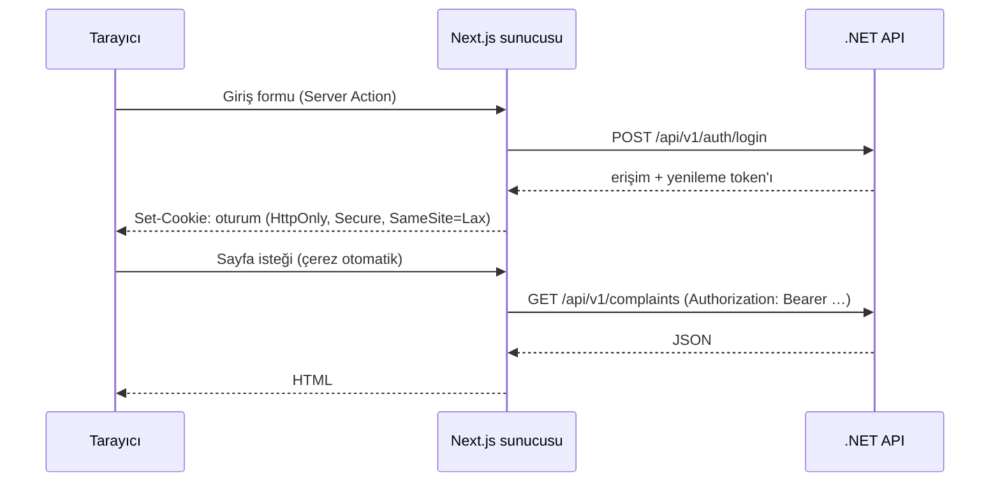

# ADR-0006 — Yönetim paneli kimlik doğrulaması: BFF ve sunucu tarafı oturum

| | |
|---|---|
| Durum | Kabul edildi (token biçimi Identity iş akışında kesinleşir) |
| Tarih | 2026-11-11 |
| İlgili | [ARCHITECTURE §6–§7](../ARCHITECTURE.md#6-kimlik-ve-yetkilendirme), [API_CONTRACT_STRATEGY §6](../API_CONTRACT_STRATEGY.md#6-kimlik-ve-yetki-belgelendirmesi) |

## Bağlam

Panel (Next.js) ve API (.NET) ayrı uygulamalardır ve Railway'de ayrı servisler olarak, **farklı alan adlarında** çalışacaktır. Bu karar iki sohbeti (Identity ve Panel) doğrudan bağladığı için önceden verilmelidir.

Kısıtlar:

- Token'lar tarayıcıda JavaScript'in erişebileceği bir yerde (`localStorage` vb.) tutulmamalıdır.
- Parola ve oturum mantığı elle yazılmamalıdır.
- Railway'in ücretsiz alan adları ortak bir "public suffix" altındadır; iki servis arasında çerez paylaşılamaz. Çapraz-site çerez (`SameSite=None`) ise tarayıcıların üçüncü taraf çerez kısıtlarına takılır ve CSRF yüzeyini büyütür.
- İş kuralları ve yetki kararları API'de kalmalıdır.

## Karar

**Backend-for-Frontend (BFF) deseni:** tarayıcı yalnızca Next.js ile konuşur; .NET API'yi yalnızca Next.js sunucusu çağırır.

1. **API tarafı:** Kullanıcılar ASP.NET Core Identity ile yönetilir. API kimliği `Authorization: Bearer` başlığındaki token ile doğrular. Kısa ömürlü erişim token'ı + yenileme token'ı verilir. API çerez kullanmaz.
2. **Panel tarafı:** Next.js sunucusu token'ları yalnızca kendi tarafında, şifrelenmiş `HttpOnly`, `Secure`, `SameSite=Lax` bir oturum çerezinde saklar. Token değeri tarayıcı JavaScript'ine hiçbir zaman verilmez.
3. **Çağrı yolu:** Tüm API çağrıları Server Component, Server Action veya Route Handler içinden yapılır. Tarayıcıdan .NET API'ye doğrudan `fetch` yoktur.
4. **Yenileme:** Erişim token'ının süresi dolduğunda Next.js sunucusu yenileme token'ıyla yeniler; başarısız olursa oturumu kapatıp giriş sayfasına yönlendirir.
5. **Yetki:** Next.js oturumun varlığına bakarak sayfa korur (kullanıcı deneyimi için), ancak **yetki kararının tek sahibi API'dir.**
6. **Dosyalar:** Fotoğraflar bir Next.js Route Handler üzerinden akıtılır; tarayıcı API'nin dosya adresini görmez.
7. **Hesap oluşturma:** Kendi kendine kayıt yoktur. Moderatörü Admin oluşturur; ilk Admin ortam değişkenlerinden tohumlanır.

### Identity iş akışına bırakılanlar

- Token biçimi: ASP.NET Core Identity'nin yerleşik bearer token desteği (opak token; anahtar yönetimi gerektirmez) **tercih edilir**; JWT ancak somut bir ihtiyaç varsa. Resmî dokümandan doğrulanarak seçilir (yol haritası V-5).
- Token ömürleri, yenileme token'ının iptali, hesap kilitleme eşikleri.

### Panel iş akışına bırakılanlar

- Oturum çerezinin şifreleme yöntemi (yerleşik olanaklar veya küçük, bakımı süren bir kütüphane).
- Server Action'ların kaynak (origin) denetimi davranışının güncel Next.js dokümanından doğrulanması (V-7).

## Gerekçe

- **CORS gerekmez:** API'ye tarayıcıdan istek gelmez; API yalnızca sunucudan sunucuya çağrılır.
- **Token XSS ile çalınamaz:** tarayıcıda yalnızca `HttpOnly` çerez vardır.
- **Alan adı kısıtından bağımsız:** çerez yalnızca panelin kendi alan adına aittir; Railway'in ortak alan adı kısıtı sorun olmaz, özel alan adı satın almak gerekmez.
- **CSRF yüzeyi dar:** `SameSite=Lax` çerez + durum değiştiren işlemlerin yalnızca POST/Server Action ile yapılması.
- **API bağımsız kalır:** Bearer token ile korunan API, ileride başka istemcilere (mobil, betik) de aynı şekilde hizmet verebilir.

## Değerlendirilen alternatifler

| Alternatif | Neden seçilmedi |
|---|---|
| API'nin doğrudan çerez vermesi (ASP.NET Core Identity çerezi), tarayıcının API'yi çağırması | Farklı alan adlarında çapraz-site çerez gerekir; üçüncü taraf çerez kısıtları ve CORS + CSRF karmaşıklığı. |
| Token'ı tarayıcıda (`localStorage`) tutmak | XSS ile çalınabilir; proje kuralı gereği yasak. |
| Harici kimlik sağlayıcı (OAuth/OIDC servisi) | Birkaç panel kullanıcısı için gereksiz dış bağımlılık ve yapılandırma. |
| Next.js tarafında ayrı kullanıcı veritabanı / auth kütüphanesi | Kimliğin iki sahibi olur; Next.js veritabanına bağlanmamalı. |
| Özel alan adı altında alt alan adlarıyla çerez paylaşımı | Alan adı maliyeti ve yapılandırması gerektirir; BFF buna ihtiyaç bırakmaz. |

## Sonuçlar

**Olumlu**

- Panel sohbeti ile Identity sohbeti arasındaki sözleşme net: giriş, yenileme, çıkış, "ben kimim" uç noktaları ve Bearer başlığı.
- Güvenlik açısından hassas değerler yalnızca sunucularda yaşar.

**Olumsuz / dikkat edilecek**

- Her istek Next.js sunucusundan geçer (ek bir atlama). Bu ölçekte önemsizdir.
- Tarayıcıda çalışan canlı güncelleme (ör. doğrudan API'ye WebSocket) bu modelde yoktur; ihtiyaç doğarsa ayrıca tasarlanır.
- Next.js tarafında bir oturum şifreleme secret'ı (`SESSION_SECRET`) yönetilmelidir.
- Çerez boyutu sınırlıdır; token'lar büyürse sunucu tarafı oturum deposu gerekebilir (opak token tercihi bu riski azaltır).
